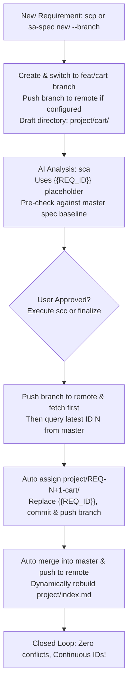

# sa-spec - System Analysis AI Workspace

[](https://www.npmjs.com/package/@loviusc/sa-spec)
[](https://opensource.org/licenses/MIT)

> A lightweight, defensive system analysis documentation workspace that turns ideas into verifiable, auditable, and conflict-checked engineering specifications for AI-driven development.

<p align="center">
  <b>🌐 Languages:</b>
  <a href="./README.en.md"><b>English</b></a> |
  <a href="./README.zh-TW.md"><b>繁體中文</b></a> |
  <a href="./README.zh-CN.md"><b>简体中文</b></a> |
  <a href="./README.ja.md"><b>日本語</b></a> |
  <a href="./README.ko.md"><b>한국어</b></a>
</p>

---

## Overview

`sa-spec` is not just a document generator; it is a **pre-development system analysis workspace**.

Before code-generation AI tools (OpenSpec, Claude Code, OpenAI Codex, Gemini CLI, Cursor) start implementation, `sa-spec` clarifies scopes, boundaries, data schemas, API contracts, permission matrices, and acceptance criteria to ensure that subsequent coding proceeds within safe, well-defined boundaries.

The AI workflow operates on five standard commands (with shorthand aliases):

| Command | Alias | Purpose | Description |
|---|---|---|---|
| `spec:init` | `sci` | Initialize | Sets up `AGENTS.md`, loads CLI built-in rules (`sa-spec instructions init`), and prompts for the target language. |
| `spec:propose` | `scp` | Propose | Summarizes objectives, user stories, workflows, and open items without altering existing requirements. |
| `spec:analyze` | `sca` | Analyze & Draft | Checks for conflicts against existing requirements, APIs, and DB schemas; drafts SRS, UML, OpenAPI, and DB schema. |
| `spec:commit` | `scc` | Commit & Archive | Archives the user-verified version, assigns sequential ID, updates indexes, and generates a local Git commit. |
| `spec:pdf` | `spd` | Export PDF | Exports a single `.md` file or an entire requirement folder (`REQ-001`) into a print-ready PDF specification. |

Each finalized requirement produces a standardized, self-contained directory:

```text
project/
  REQ-001-login/
    srs.md           # Software Requirements Specification
    uml/
      main.puml      # Standalone PlantUML diagrams (single-diagram-per-file)
    openapi.yaml     # OpenAPI 3.0 specification draft
    db-schema.md     # Database schema and migration draft
    handoff.md       # AI developer handoff brief (OpenSpec / Claude Code entry point)
    history.md       # Version history and decision audit trail
```

---

## Design Philosophy

```text
sa-spec defines what to build and its constraints; AI code tools build it right.
```

1. **Defensive Impact Assessment**: `spec:analyze` enforces conflict detection. It explicitly checks whether a new requirement mutates existing roles, permissions, API signatures, or database tables, preventing regressions and security flaws.
2. **Deterministic State Machine**: `propose -> analyze -> commit`. The AI is strictly prohibited from inventing unconfirmed business assumptions or hallucinating table columns. If conflicts are detected, document generation halts until the user clarifies.
3. **AI Developer Handoff (`handoff.md`)**: Acts as a concise, unambiguous constraint summary for development tools like OpenSpec, Claude Code, or Codex, detailing what to implement, what NOT to touch, and exact acceptance criteria.

---

## Installation

### Prerequisites
- Node.js 18 or above
- npm
- Git

### Cross-Platform Standalone Scripts (`.sh` / `.bat`)

```bash
# macOS / Linux
./install.sh          # Install sa-spec
./update.sh           # Update sa-spec to latest version
./uninstall.sh        # Uninstall sa-spec

# Windows (double-click or run via CMD / PowerShell)
install.bat
update.bat
uninstall.bat
```

### Global Installation via npm

```bash
npm install -g @loviusc/sa-spec
```

Verify installation:

```bash
sa-spec help
sa-spec --version
```

---

## CLI Commands

| Command | Description |
|---|---|
| `sa-spec init [--full] [--hooks] [--lang <lang>]` | Scaffolds a clean workspace skeleton without exposing `skills/` or `rules/` folders (`--full` kept for compatibility; `--hooks` installs the Git `pre-commit` guardrail). Supports `zh-TW`, `en`, `zh-CN`, `ja`, `ko`. |
| `sa-spec new [--id REQ-001] --name login [--slug login] [--branch]` | Creates a requirement folder template (pass `--slug <ascii-slug>` for non-ASCII/CJK names). Omitting `--id` starts a draft in a feature branch (`feat/<slug>`). |
| `sa-spec finalize --name login [--slug login] [--no-merge \| --pr]` | Assigns the latest available sequential ID to a draft requirement, renames directory, substitutes `{{REQ_ID}}`, regenerates index, and handles merge/PR mode (`Merge Strategy: pr`) with remote collision guard. |
| `sa-spec instructions [stage] [--with-rules] [--json]` | Prints live workspace context, workflow steps, language directive, and built-in `SKILL.md` guidance for a stage (`init`, `propose`, `analyze`, `commit`, `pdf`). |
| `sa-spec rules [name\|all] [--list] [--json]` | Reads or lists built-in analysis rule documents bundled in the package. |
| `sa-spec templates [name] [--lang <code>] [--list] [--json]` | Reads or lists built-in document and PlantUML templates localized for the workspace language or `--lang`. |
| `sa-spec pdf <target> [--split] [--output out.pdf] [--browser <path>] [--online-uml \| --no-uml-render]` | Converts a `.md` file or requirement (`REQ-001`) to a merged or split PDF (privacy-safe by default: uses local `plantuml`, or `--online-uml` / `SA_SPEC_PLANTUML_SERVER` if explicitly requested). |
| `sa-spec reindex` | Scans `project/REQ-*` directories and dynamically rebuilds `project/index.md` sorted by numerical ID with extracted SRS title and summary. |
| `sa-spec check [--strict] [--json] [--allow-multi-req]` | Validates required files, duplicate IDs, cross-file consistency, OpenAPI YAML structure, and deliverable integrity (`--json` emits machine-readable rule codes & fix hints; `--strict` also fails on version mismatch, legacy `skills/`/`rules/`, or unflagged multi-`REQ-*` edits unless `--allow-multi-req` is passed). |
| `sa-spec hooks [install\|remove\|status] [--force]` | Installs, removes, or checks the Git `pre-commit` hook that automatically runs `sa-spec check --strict` before commits (preserving custom hooks unless `--force` is given). |
| `sa-spec status` | Displays overview status of requirements and specs. |
| `sa-spec doctor` | Diagnostic tool to verify workspace integrity. |
| `sa-spec upgrade [--dry-run] [--keep-legacy]` | Upgrades `AGENTS.md`, removes legacy managed `skills/` and `rules/` files (preserving custom files and language), and migrates legacy `uml.puml`. Alias: `sa-spec update`. |

---

## Multi-User Collaboration & Git-Flow

To solve sequential ID collisions and Git merge conflicts in team environments, `sa-spec` introduces **Feature Branch Isolation + Late-Binding ID**:



1. **Draft Phase (No ID Contention)**: Run `sa-spec new --name checkout --branch` or prompt `scp checkout` in AI chat. It creates `feat/checkout` (and automatically pushes it to Git remote if configured) and `project/checkout/` using `{{REQ_ID}}`. Parallel branches never collide. If an idea is abandoned, deleting the branch leaves zero ghost IDs.
2. **Baseline Protection**: `spec:analyze` fetches latest `master` before analyzing to prevent missing newly merged API or table changes.
3. **Late-Binding Finalize, Auto-Merge & Remote Push**: Running `scc` in AI chat (or `sa-spec finalize --name checkout`) first pushes the feature branch to remote (if a remote exists) and syncs remote refs, then inspects master's latest ID, assigns `REQ-xxx`, replaces placeholders, commits, **automatically merges into master** (`git checkout master && git merge feat/checkout`), updates `project/index.md`, and pushes `master` to remote.
4. **Conflict-Free Reindex**: `sa-spec reindex` builds `project/index.md` on the fly from disk.

---

## Internationalization (i18n)

`sa-spec` supports 5 primary languages:

| Code | Language | Text & Style Guideline | Technical Terminology Rule |
|---|---|---|---|
| `en` | **English** | 100% standard technical English | Standard technical English |
| `zh-TW` | **繁體中文** (Default) | Traditional Chinese (Taiwan terminology) | Retain native English terms (`REST API`, `Webhook`, `JWT`) |
| `zh-CN` | **简体中文** | Simplified Chinese (Mainland terminology) | Retain native English terms (`REST API`, `Webhook`, `JWT`) |
| `ja` | **日本語** | Japanese technical prose with Katakana loanwords | Retain native English terms (`REST API`, `Webhook`, `JWT`) |
| `ko` | **한국어** | Korean technical prose with standard honorifics | Retain native English terms (`REST API`, `Webhook`, `JWT`) |

### Core Rules:
1. **Init-Time Language Lock**: Set via `sa-spec init --lang en` or selected interactively upon `spec:init`.
2. **Single-Language Purity**: The entire project must strictly adhere to the declared language.
3. **Technical Terms in Native English**: In non-English modes, standard industry terms (`REST API`, `Webhook`, `JWT`, `OAuth 2.0`, `Payload`, `Idempotency Key`, `Redis`, `UUID`) must remain in native English without awkward literal translations.
4. **Upgrade Protection**: `sa-spec upgrade` automatically detects and respects existing project language without overwriting.

---

## AI Developer Handoff

Once a requirement is finalized via `scc`, pass `handoff.md` to your development agent:

```text
Please read project/REQ-001-login/handoff.md first as the primary implementation entry point.
Refer to srs.md, uml/, openapi.yaml, and db-schema.md in the same directory for detailed contracts.
Do not invent unconfirmed roles, APIs, or database columns.
```

---

## License

MIT © [lovius](https://github.com/lovius215)
