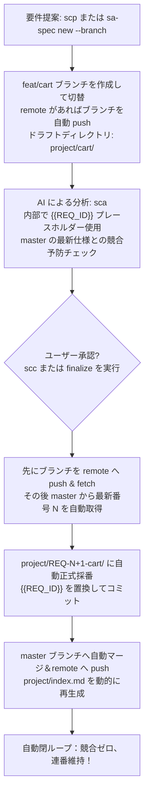

# sa-spec - システム分析 AI ワークスペース

[](https://www.npmjs.com/package/@loviusc/sa-spec)
[](https://opensource.org/licenses/MIT)

> 要件やアイデアを、確認可能・監査可能・コンフリクト検出可能なエンジニアリング仕様書へと整理する、AI主導開発向けシステム分析（SA）ドキュメント・ワークスペース。

<p align="center">
  <b>🌐 言語ナビゲーション (Languages):</b>
  <a href="./README.en.md"><b>English</b></a> |
  <a href="./README.zh-TW.md"><b>繁體中文</b></a> |
  <a href="./README.zh-CN.md"><b>简体中文</b></a> |
  <a href="./README.ja.md"><b>日本語</b></a> |
  <a href="./README.ko.md"><b>한국어</b></a>
</p>

---

## 概要

`sa-spec` は単なる AI ドキュメント生成ツールではなく、**AI コーディング前に行う「システム分析（System Analysis）ワークスペース」** です。

OpenSpec、Claude Code、OpenAI Codex、Gemini CLI などの AI 開発ツールがコード実装を始める前に、要件のスコープ、境界線、データモデル、API 規約、権限マトリクス、受入条件を事前に明確化し、安全で堅牢な開発境界を定義します。

AI ワークフローは 5 つの標準コマンド（エイリアス対応）で動作します：

| コマンド | エイリアス | 目的 | 説明 |
|---|---|---|---|
| `spec:init` | `sci` | 初期化 | `AGENTS.md` と CLI 組み込みルール（`sa-spec instructions init`）を読み込み、言語設定を確定します。 |
| `spec:propose` | `scp` | 要件提案 | 既存の仕様を変更せず、目的・概要・初期フロー・確認事項を整理します。 |
| `spec:analyze` | `sca` | 分析と起草 | 既存の要件、API、DB スキーマとの競合をチェックし、問題がなければ SRS、UML、OpenAPI、DB スキーマのドラフトを作成します。 |
| `spec:commit` | `scc` | 確認と保存 | ユーザーが承認したバージョンを正式に採番・保存し、インデックスを更新して Git コミットを作成します。 |
| `spec:pdf` | `spd` | PDF 出力 | 指定した `.md` ファイルまたは要件ディレクトリ（`REQ-001` など）を PDF 仕様書として出力します。 |

各要件フォルダーには以下の標準成果物が生成されます：

```text
project/
  REQ-001-login/
    srs.md           # ソフトウェア要件仕様書 (SRS)
    uml/
      sequence.puml  # 独立した PlantUML 図（1ファイル1図の原則）
    openapi.yaml     # OpenAPI 3.0 ドラフト
    db-schema.md     # データベーススキーマ仕様書
    handoff.md       # AI 開発ツール向け引き継ぎ要約 (OpenSpec / Claude Code エントリポイント)
    history.md       # 変更履歴および意思決定ログ
```

---

## 設計思想

```text
sa-spec が仕様と境界を明確にし、AI 開発ツールが正しく実装する。
```

1. **防御的な影響評価**: `spec:analyze` は競合チェックを強制します。新しい要件が既存の権限、API シグネチャ、DB テーブルを意図せず上書き・破壊しないかを厳密に検証します。
2. **決定論的ステートマシン**: `propose -> analyze -> commit` の流れを遵守します。AI が未確認の業務ルールやテーブルカラムを勝手に捏造することを防ぎます。競合が発見された場合は生成を停止し、人間の指示を仰ぎます。
3. **AI 開発引き継ぎサマリー (`handoff.md`)**: 実装すべき内容、触れてはならない境界、API 契約、受入条件を凝縮し、後続の AI 開発ツールに安全なガイドラインを提供します。

---

## インストールと利用準備

### 前提環境
- Node.js 18 以上
- npm
- Git

### クロスプラットフォーム独立スクリプト (`.sh` / `.bat`)

```bash
# macOS / Linux
./install.sh          # インストール
./update.sh           # 最新版へアップデート
./uninstall.sh        # アンインストール

# Windows（ダブルクリック、または CMD / PowerShell で実行）
install.bat
update.bat
uninstall.bat
```

### グローバルインストール

```bash
npm install -g @loviusc/sa-spec
```

インストールの確認：

```bash
sa-spec help
sa-spec --version
```

---

## CLI コマンド一覧

| コマンド | 説明 |
|---|---|
| `sa-spec init [--full] [--hooks] [--lang <lang>]` | `skills/` や `rules/` をプロジェクトに出力せずクリーンな骨格を初期化します（`--full` は互換用・`--hooks` で Git `pre-commit` ガードレールも導入・5 言語対応）。 |
| `sa-spec new [--id REQ-001] --name login [--slug login] [--branch]` | 要件テンプレートを作成します（日本語など非 ASCII 名には `--slug <ascii-slug>` を指定）。`--id` を省略すると `feat/<slug>` ドラフトモードで開始します。 |
| `sa-spec finalize --name login [--slug login] [--no-merge \| --pr]` | ドラフト要件に最新の連続番号を割り当て、`--no-merge` / `--pr` または `マージ戦略：pr` に対応しつつ他ブランチ含むリモート番号競合を防止します。 |
| `sa-spec instructions [stage] [--with-rules] [--json]` | 現在のワークスペース状態、言語指示ディレクティブ、各段階の組み込み規範を出力します。 |
| `sa-spec rules [name\|all] [--list] [--json]` | パッケージに組み込まれた補助ルールの一覧表示または内容参照を行います。 |
| `sa-spec templates [name] [--lang <code>] [--list] [--json]` | プロジェクト言語または `--lang` に合わせてローカライズされたテンプレートを表示します。 |
| `sa-spec pdf <target> [--split] [--html] [--output out.pdf] [--browser <path>] [--online-uml \| --no-uml-render]` | 指定した `.md` または要件（`REQ-001`）を PDF 出力します（`--html` でブラウザ不要のスタンドアロン HTML 出力も可・デフォルトはローカル `plantuml` のみ）。 |
| `sa-spec impact [--json]` | `project/` をスキャンし、要件間の API / DB 影響マトリクスと重複候補を軽量出力します（`instructions analyze` にも自動統合）。 |
| `sa-spec reindex` | `project/REQ-*` をスキャンし、SRS のタイトル・概要を抽出して `project/index.md` を再構築します。 |
| `sa-spec check [--strict] [--json] [--allow-multi-req]` | 必須ファイル・番号重複・ドキュメント間整合性・OpenAPI YAML 構造・成果物完全性を検証します（`--json` で機械可読な修正ヒントを出力、`--strict` ではバージョン不一致・旧 `skills/`/`rules/`・複数 `REQ-*` 同時変更も失敗扱い、`--allow-multi-req` で許可）。 |
| `sa-spec hooks [install\|remove\|status] [--force]` | コミット前に `sa-spec check --strict` を自動実行する Git `pre-commit` hook を導入・削除・確認します（既存のカスタム hook は保護）。 |
| `sa-spec status` | 要件とシステム仕様の概要ステータスを表示します。 |
| `sa-spec doctor` | ワークスペースの依存関係と整合性を診断します。 |
| `sa-spec upgrade [--dry-run] [--keep-legacy]` | `AGENTS.md` を更新し、旧版パッケージ管理下の `skills/`・`rules/` を削除（独自ファイルと言語は保持）し、旧 `uml.puml` を移行します。別名：`sa-spec update`。 |

---

## チーム開発と Git-Flow（遅延採番アーキテクチャ）

複数人での並行開発時に発生する「要件番号の競合」や「Git マージコンフリクト」を防ぐため、**Feature Branch 隔離 + 遅延バインディング（Late-Binding ID）** を採用しています：



1. **ドラフト時は番号を奪い合わない**: `scp` または `sa-spec new --branch` でブランチを切り（Git remote が設定されていれば自動的に remote へ push）、`project/cart/` と `{{REQ_ID}}` を使って作業します。途中で要件を破棄する場合も、ブランチを削除するだけで済み、欠番（ゴーストID）を残しません。
2. **基線同期で競合見落としを防止**: `spec:analyze` の実行前に master の最新状態を取得し、他メンバーがマージした最新の API やテーブル変更を反映して競合チェックを行います。
3. **先行 push・自動採番・主ブランチ自動マージ**: `scc` または `sa-spec finalize` を実行すると、remote が存在する場合は**まずブランチを remote に push して同期**した後、**master から次の番号を自動取得して採番・置換・コミット**し、**master ブランチへ自動切り替え＆自動マージ・`project/index.md` 再生成・remote への自動 push** までを一気通貫で行います。
4. **インデックスのコンフリクト解消**: `sa-spec reindex` でディレクトリから常に決定論的に `project/index.md` を再構築します。

---

## 国際化（i18n）対応

`sa-spec` は 5 つの主要言語を正式にサポートしています：

| コード | 言語名 | 文体・表記ガイドライン | 技術用語の取り扱い原則 |
|---|---|---|---|
| `ja` | **日本語** | 日本語技術文体（です/ます、またはである調） | 業界標準の英語用語を維持（`REST API`, `Webhook`, `JWT`） |
| `en` | **English** | 100% 標準的な技術英文 | 原文の標準英語 |
| `zh-TW` | **繁體中文** (既定) | 台湾の標準的な技術用語 | 業界標準の英語用語を維持（`REST API`, `Webhook`, `JWT`） |
| `zh-CN` | **简体中文** | 中国本土の標準的な技術用語 | 業界標準の英語用語を維持（`REST API`, `Webhook`, `JWT`） |
| `ko` | **한국어** | 韓国語の専門技術文体と敬語 | 業界標準の英語用語を維持（`REST API`, `Webhook`, `JWT`） |

### 重要ルール：
1. **初期化時の言語確定**: `sa-spec init --lang ja` または `spec:init` 時に対話形式で言語を決定し、`project/system-spec.md` に記録します。
2. **単一言語の一貫性**: プロジェクト内の全仕様書は選択した言語に統一されます。
3. **技術専門用語の英語表記維持**: 非英語モードであっても、標準的な技術用語（`REST API`、`Webhook`、`JWT`、`OAuth 2.0`、`Payload`、`Idempotency Key`、`Redis` など）は無理な直訳を避け、**原語の英語表記を強制維持**します。
4. **アップグレード時の言語保護**: `sa-spec upgrade` は既存プロジェクトの言語を自動検知し、言語設定を勝手に変更しません。

---

## ライセンス

MIT © [lovius](https://github.com/lovius215)
