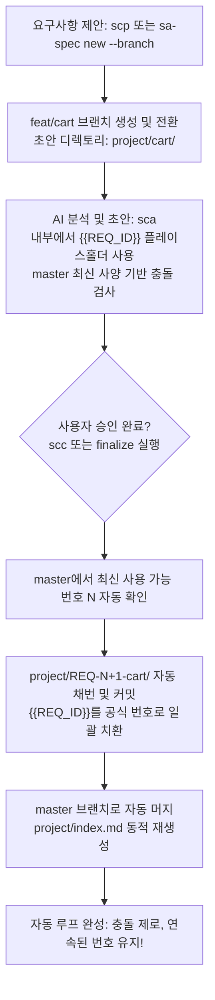

# sa-spec - 시스템 분석 AI 워크스페이스

[](https://www.npmjs.com/package/@loviusc/sa-spec)
[](https://opensource.org/licenses/MIT)

> 요구사항과 아이디어를 검증 가능하고, 감사 가능하며, 충돌 검사가 완료된 엔지니어링 기술 사양서로 정리하는 AI 기반 개발용 시스템 분석(SA) 문서 워크스페이스입니다.

<p align="center">
  <b>🌐 언어 선택 (Languages):</b>
  <a href="./README.en.md"><b>English</b></a> |
  <a href="./README.zh-TW.md"><b>繁體中文</b></a> |
  <a href="./README.zh-CN.md"><b>简体中文</b></a> |
  <a href="./README.ja.md"><b>日本語</b></a> |
  <a href="./README.ko.md"><b>한국어</b></a>
</p>

---

## 개요

`sa-spec`은 단순한 AI 문서 생성 도구가 아니라, **AI 개발 착수 전의 "시스템 분석(System Analysis) 워크스페이스"** 입니다.

OpenSpec, Claude Code, OpenAI Codex, Gemini CLI 등 코드 생성 AI 도구가 구현을 시작하기 전에, 요구사항의 범위, 경계, 데이터 모델, API 인터페이스, 권한 매트릭스, 인수 조건을 사전에 명확히 정의하여 후속 개발이 안전하고 명확한 경계 내에서 진행되도록 보장합니다.

AI 워크플로는 4가지 표준 명령어(별칭 지원)를 기반으로 동작합니다:

| 표준 명령어 | 별칭 | 단계 | 설명 |
|---|---|---|---|
| `spec:init` | `sci` | 초기화 | `AGENTS.md`, 시스템 규칙 및 지정된 언어 프롬프트를 로드합니다. |
| `spec:propose` | `scp` | 요구사항 제안 | 기존 사양을 변경하지 않고 목표, 요약, 초기 흐름 및 미확인 사항을 정리합니다. |
| `spec:analyze` | `sca` | 분석 및 초안 작성 | 기존 요구사항, API, DB와의 충돌 여부를 검사하고, 문제가 없을 때만 SRS, UML, OpenAPI, DB Schema 초안을 작성합니다. |
| `spec:commit` | `scc` | 확인 및 보관 | 사용자가 승인한 버전을 정식 번호로 보관하고, 인덱스를 갱신하며 로컬 Git 커밋을 생성합니다. |

보관된 각 요구사항은 독립적이고 완전한 폴더로 구성됩니다:

```text
project/
  REQ-001-login/
    srs.md           # 소프트웨어 요구사항 명세서 (SRS)
    uml/
      main.puml      # 독립 PlantUML 다이어그램 (파일당 1개 다이어그램 원칙)
    openapi.yaml     # OpenAPI 3.0 사양 초안
    db-schema.md     # 데이터베이스 스키마 및 마이그레이션 정의
    handoff.md       # AI 개발 도구 인수인계 요약 (OpenSpec / Claude Code 진입점)
    history.md       # 버전 이력 및 설계 결정 감사 로그
```

---

## 설계 철학

```text
sa-spec이 요구사항과 경계를 명확히 정의하고, AI 개발 도구가 올바르게 구현합니다.
```

1. **방어적 영향도 평가**: `spec:analyze`는 충돌 검사를 강제합니다. 새로운 요구사항이 기존의 역할, 권한, API 서명, 데이터베이스 테이블을 무단으로 변경하지 않는지 사전에 철저히 검증합니다.
2. **결정론적 상태 머신**: `propose -> analyze -> commit` 흐름을 엄격히 준수합니다. AI가 확인되지 않은 비즈니스 가설이나 테이블 컬럼을 임의로 날조(환각)하는 것을 방지하며, 충돌 발생 시 즉시 생성을 중단하고 사용자 확인을 요청합니다.
3. **AI 개발 인수인계서 (`handoff.md`)**: 구현해야 할 내용, 변경해서는 안 되는 경계, API 계약 및 인수 조건을 간결하게 정리하여 개발 AI 도구의 안전한 나침반 역할을 수행합니다.

---

## 설치 및 준비

### 필수 환경
- Node.js 18 이상
- npm
- Git

### npm 글로벌 설치

```bash
npm install -g @loviusc/sa-spec
```

설치 확인:

```bash
sa-spec help
sa-spec --version
```

---

## CLI 명령어 안내

| 명령어 | 설명 |
|---|---|
| `sa-spec init [--full] [--lang <lang>]` | 워크스페이스 골격을 생성합니다 (`zh-TW`, `en`, `zh-CN`, `ja`, `ko` 지원, 기본값 `zh-TW`). |
| `sa-spec new [--id REQ-001] --name login [--branch]` | 요구사항 템플릿 폴더를 생성합니다. `--id` 생략 시 다중 사용자 초안 브랜치(`feat/<name>`)로 생성됩니다. |
| `sa-spec finalize --name login` | 초안 요구사항에 최신 연속 번호를 할당하고 폴더명 변경, `{{REQ_ID}}` 치환 및 인덱스를 자동 재구축합니다. |
| `sa-spec reindex` | `project/REQ-*` 디렉토리를 스캔하여 번호순으로 정렬된 `project/index.md`를 동적으로 재생성합니다. |
| `sa-spec check` | 필수 파일과 시스템 사양 상태를 검증합니다. |
| `sa-spec status` | 요구사항 및 시스템 사양 현황을 확인합니다. |
| `sa-spec doctor` | 워크스페이스 무결성 및 필수 의존 파일을 진단합니다. |
| `sa-spec upgrade [--dry-run]` | 기존 프로젝트의 언어 설정을 유지하면서 규칙과 스킬을 최신 버전으로 업그레이드합니다. |

---

## 팀 협업 및 Git-Flow (지연 바인딩 아키텍처)

팀 내 동시 병렬 개발 시 발생하는 "일련번호 충돌" 및 "Git 머지 컨플릭트"를 해결하기 위해 **Feature Branch 격리 + 지연 바인딩(Late-Binding ID)** 방식을 적용했습니다:



1. **초안 단계 번호 미선점**: `scp` 또는 `sa-spec new --branch` 명령으로 독립 브랜치를 생성하고 `project/cart/`와 `{{REQ_ID}}` 플레이스홀더를 사용합니다. 요구사항이 중도 폐기되어도 브랜치만 삭제하면 되며, 결번(고스트 번호)이 발생하지 않습니다.
2. **사양 기준선 동기화**: `spec:analyze` 실행 전 master의 최신 상태를 동기화하여 다른 팀원이 머지한 API나 테이블과의 충돌 누락을 방지합니다.
3. **자동 신규 번호 채번 및 메인 브랜치 자동 머지**: `scc` 또는 `sa-spec finalize` 실행 시 **master에서 다음 번호를 자동 조회하여 채번·치환·커밋**하고, **master 브랜치로 자동 전환 후 자동 머지**를 수행하며 `project/index.md`를 최신 상태로 정렬 재생성합니다.
4. **인덱스 머지 충돌 제거**: `sa-spec reindex` 명령으로 디렉토리 상태에서 `project/index.md`를 언제든 완벽하게 재생성합니다.

---

## 국제화 (i18n) 지원

`sa-spec`은 5가지 주요 언어를 지원합니다:

| 코드 | 언어 | 텍스트 및 스타일 규격 | 전문 기술 용어 원칙 |
|---|---|---|---|
| `ko` | **한국어** | 한국어 전문 기술 문체 및 경어 | 업계 표준 영어 용어 유지 (`REST API`, `Webhook`, `JWT`) |
| `en` | **English** | 100% 표준 기술 영어 | 원문 표준 영어 |
| `zh-TW` | **繁體中文** (기본값) | 대만 표준 기술 용어 | 업계 표준 영어 용어 유지 (`REST API`, `Webhook`, `JWT`) |
| `zh-CN` | **简体中文** | 중국 본토 표준 기술 용어 | 업계 표준 영어 용어 유지 (`REST API`, `Webhook`, `JWT`) |
| `ja` | **日本語** | 일본어 기술 문체 및 가타카나 외래어 | 업계 표준 영어 용어 유지 (`REST API`, `Webhook`, `JWT`) |

### 핵심 원칙:
1. **초기화 시점 언어 고정**: `sa-spec init --lang ko` 또는 `spec:init` 시점에 대화형으로 선택하여 `project/system-spec.md`에 기록합니다.
2. **단일 언어의 순수성**: 프로젝트 내의 모든 사양 문서는 선택된 언어로 100% 통일됩니다.
3. **기술 전문 용어의 영어 유지**: 비영어권 모드에서도 업계 표준 기술 용어(`REST API`, `Webhook`, `JWT`, `OAuth 2.0`, `Payload`, `Idempotency Key`, `Redis` 등)는 억지 번역을 지양하고 **원문 영어를 강제 유지**합니다.
4. **업그레이드 보호**: `sa-spec upgrade` 실행 시 기존 프로젝트의 언어 설정을 자동으로 감지하여 유지합니다.

---

## 라이선스

MIT © [lovius](https://github.com/lovius215)
