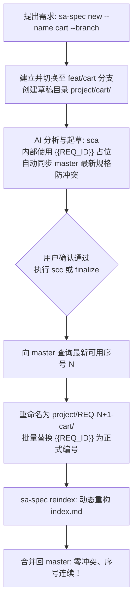

# sa-spec - 个人系统分析 AI 工作台

[](https://www.npmjs.com/package/@loviusc/sa-spec)
[](https://opensource.org/licenses/MIT)

> 轻量级、防御性的系统分析文档工作台。通过固定流程把业务想法整理为可确认、可归档、可检查的技术规格文档，为 AI 辅助开发提供明确边界。

<p align="center">
  <b>🌐 语言导航 (Languages):</b>
  <a href="./README.en.md"><b>English</b></a> |
  <a href="./README.zh-TW.md"><b>繁體中文</b></a> |
  <a href="./README.zh-CN.md"><b>简体中文</b></a> |
  <a href="./README.ja.md"><b>日本語</b></a> |
  <a href="./README.ko.md"><b>한국어</b></a>
</p>

---

## 核心概述

`sa-spec` 的定位不是单纯的 AI 文档生成器，而是 **AI 开发前的系统分析工作台**。

在 OpenSpec、Claude Code、OpenAI Codex、Gemini CLI 等代码生成工具介入之前，`sa-spec` 先行厘清需求边界、业务规则、数据模型、API 契约、权限矩阵与验收条件，避免 AI 编码时随心所欲破坏系统架构。

AI 工作流使用四个标准指令（支持简写别名）：

| 标准指令 | 简写 | 阶段 | 说明 |
|---|---|---|---|
| `spec:init` | `sci` | 初始化 | 加载 `AGENTS.md`、系统分析规则与指定语言的规范文件。 |
| `spec:propose` | `scp` | 提出需求 | 整理需求摘要、目标、初步流程与待确认事项，不修改已有规格。 |
| `spec:analyze` | `sca` | 分析与起草 | 检查新需求是否与既有需求、API、DB 发生冲突；无冲突才产出 SRS、UML、OpenAPI 与 DB Schema 草案。 |
| `spec:commit` | `scc` | 确认归档 | 用户确认后正式定号归档，更新索引与系统总表，并自动创建本地 Git commit。 |

每个归档的需求固定包含一个独立完整的文件夹：

```text
project/
  REQ-001-login/
    srs.md           # 软件需求规格说明书 (SRS)
    uml/
      main.puml      # 独立 PlantUML 图（单文件单图原则）
    openapi.yaml     # OpenAPI 3.0 接口草案
    db-schema.md     # 数据库表结构与变更说明
    handoff.md       # AI 开发者交接摘要 (面向 OpenSpec / Claude Code)
    history.md       # 版本历程与设计决策审计记录
```

---

## 设计理念

```text
sa-spec 先把需求说清楚、定好边界；AI 代码工具再把需求实现出来。
```

1. **防御性影响评估**：`spec:analyze` 强制执行冲突检查。特别关注新需求是否会无意间篡改既有角色、权限、API 签名或数据表字段，规避线上安全隐患与逻辑破坏。
2. **确定性状态机**：遵循 `propose -> analyze -> commit` 状态流转。严禁 AI 凭空臆造未确认的业务规则。发现冲突必须立即暂停，交由人工厘清。
3. **AI 开发交接摘要 (`handoff.md`)**：提炼已确认的规则、禁止触碰的边界、API 规范与验收标准，作为后续 AI 编码工具的统一入口。

---

## 安装与快速上手

### 环境准备
- Node.js 18 或以上
- npm
- Git

### 全局安装

```bash
npm install -g @loviusc/sa-spec
```

验证安装：

```bash
sa-spec help
sa-spec --version
```

---

## CLI 指令一览

| 指令 | 说明 |
|---|---|
| `sa-spec init [--full] [--lang <lang>]` | 初始化工作台骨架（支持 `zh-TW`、`en`、`zh-CN`、`ja`、`ko`，默认 `zh-TW`）。 |
| `sa-spec new [--id REQ-001] --name login [--branch]` | 创建需求模板文件夹。省略 `--id` 时自动切入多人协作草稿分支（`feat/<name>`）。 |
| `sa-spec finalize --name login` | 将草稿需求正式定号归档为最新序号，自动重命名目录、替换 `{{REQ_ID}}` 并重构索引。 |
| `sa-spec reindex` | 扫描 `project/REQ-*` 目录，按序数字顺序动态重新生成 `project/index.md`。 |
| `sa-spec check` | 检查项目必要文件与规格完整性。 |
| `sa-spec status` | 查看系统规格与需求总览状态。 |
| `sa-spec doctor` | 诊断工作区环境与必要文件依赖。 |
| `sa-spec upgrade [--dry-run]` | 将规则与技能升级至最新版，自动保留原语言与历史上下文。 |

---

## 多人协作与 Git-Flow（延迟绑定序号）

为解决团队多人并行开发时“序号争抢”与“Git 合并冲突”的痛点，`sa-spec` 采用 **Feature Branch 隔离 + 延迟定号机制（Late-Binding ID）**：



1. **草稿不抢号**：在分支开发时使用 `project/cart/` 与 `{{REQ_ID}}` 占位符。多人同时提出需求互不冲突。如果需求放弃，直接删除分支，**绝不遗留幽灵跳号**。
2. **基线同步防漏检**：执行 `spec:analyze` 前先确认同步远端 master 规格，确保以全系统最新状态进行冲突检查。
3. **归档时原子定号**：执行 `sa-spec finalize` 或 `scc` 时向 master 申请下一个号（例如 `REQ-003`），批量替换并更新。
4. **动态重建索引**：`sa-spec reindex` 随时可由目录动态排序生成总表，消除 `index.md` 的 merge conflict。

---

## 国际化多语言支持（i18n）

`sa-spec` 完整支持 5 种主要语言：

| 语系代码 | 语言名称 | 文本风格规范 | 专有名词处理惯例 |
|---|---|---|---|
| `zh-CN` | **简体中文** | 中国大陆技术用语（如：项目、服务器、支持、默认） | 强制保留原生英文（如 `REST API`, `Webhook`, `JWT`） |
| `en` | **English** | 100% 标准技术英文，无中/日/韩字符 | 原生标准英文 |
| `zh-TW` | **繁體中文** (默认) | 台湾地区技术常用语（如：專案、伺服器、支援） | 强制保留原生英文（如 `REST API`, `Webhook`, `JWT`） |
| `ja` | **日本語** | 日语标准技术文体与 Katakana 外来词 | 强制保留原生英文（如 `REST API`, `Webhook`, `JWT`） |
| `ko` | **한국어** | 韩语专业技术文体与标准敬语 | 强制保留原生英文（如 `REST API`, `Webhook`, `JWT`） |

### 核心规范：
1. **初始化锁死**：通过 `sa-spec init --lang zh-CN` 或在 `spec:init` 交互式提示中选定，写入 `project/system-spec.md`。
2. **全项目语言纯粹**：同一项目内所有需求规格必须 100% 使用该语言，不得杂糅。
3. **技术专有名词保留原生英文**：非英语系模式下，业界公认的成熟技术术语（如 `REST API`, `Webhook`, `JWT`, `OAuth 2.0`, `Payload`, `Idempotency Key`, `Redis` 等）**强制保持原生英文，禁止生硬直译**。
4. **升级保护**：执行 `sa-spec upgrade` 时自动继承既有项目语言，不打扰用户。

---

## 开源协议

MIT © [lovius](https://github.com/lovius215)
