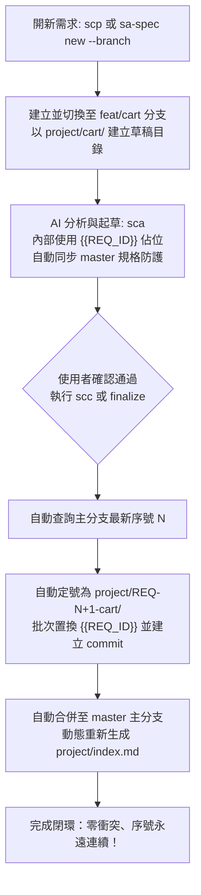
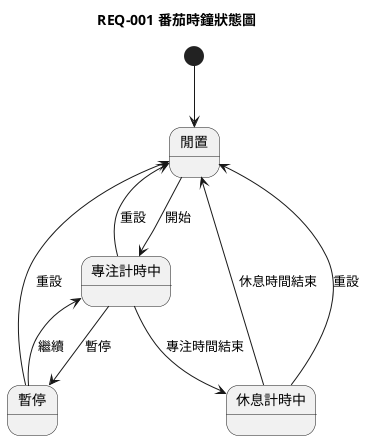

# 個人系統分析 AI 工作台 / System Analysis AI Workspace

[](https://www.npmjs.com/package/@loviusc/sa-spec)
[](https://opensource.org/licenses/MIT)

> A lightweight system analysis documentation workspace CLI that turns ideas into verifiable, auditable, and conflict-checked specifications for AI-driven development.
> 輕量級系統分析文件工作台，用固定流程把需求想法整理成可確認、可歸檔、可檢查的規格文件。

<p align="center">
  <b>🌐 Languages:</b>
  <a href="./README.en.md"><b>English</b></a> |
  <a href="./README.zh-TW.md"><b>繁體中文</b></a> |
  <a href="./README.zh-CN.md"><b>简体中文</b></a> |
  <a href="./README.ja.md"><b>日本語</b></a> |
  <a href="./README.ko.md"><b>한국어</b></a>
</p>

---

### Quick Start

```bash
# 1. Global installation via npm
npm install -g @loviusc/sa-spec

# 2. Initialize project specification rules (supports zh-TW, en, zh-CN, ja, ko)
sa-spec init --full
```

**🤖 Core AI Workflow in Chat (VS Code / Claude / Antigravity / Cursor):**
- `spec:init` (`sci`) $\to$ 鎖定專案主要語言與系統規格基準
- `spec:propose` (`scp`) $\to$ **AI 自動建立 feature 分支與草稿目錄**（零手動指令）
- `spec:analyze` (`sca`) $\to$ AI 衝突檢查並產出規格文件草稿
- `spec:commit` (`scc`) $\to$ **AI 自動向主分支領取新號並自動合併回主分支！**

👉 **Language Guides: [English](./README.en.md) | [繁體中文](./README.zh-TW.md) | [简体中文](./README.zh-CN.md) | [日本語](./README.ja.md) | [한국어](./README.ko.md)**

---

`sa-spec` 是一個輕量的系統分析文件工作台，用固定流程把需求想法整理成可確認、可歸檔、可檢查的文件。

AI 工作流只使用四個指令，並支援簡寫別名（兩者等價）：

| 標準指令 | 簡寫 | 說明 |
|---|---|---|
| `spec:init` | `sci` | 初始化專案與規則 |
| `spec:propose` | `scp` | 提出需求並整理摘要 |
| `spec:analyze` | `sca` | 衝突檢查與規格起草 |
| `spec:commit` | `scc` | 確認歸檔並建立 Git commit |

每個需求歸檔後固定包含：

```text
project/
  REQ-001-login/
    srs.md
    uml/
      main.puml
    openapi.yaml
    db-schema.md
    handoff.md
    history.md
```

## 設計理念

`sa-spec` 的定位不是單純的 AI 文件產生器，而是 AI 開發前的系統分析工作台。

它的核心價值，是在 OpenSpec、Codex、Claude、Gemini 等 AI 開發工具開始實作之前，先把需求、限制、衝突、權限、資料、API、DB 與驗收條件釐清，讓後續開發有明確邊界。

從資深系統分析師的角度看，最重要的是 `spec:analyze` 會強制進行影響評估，特別檢查新需求是否改變既有角色、權限或資料存取規則。這些區域通常是系統迭代中最高風險的地方，一旦被新需求無意間覆寫，可能造成資安漏洞、資料外洩或業務邏輯崩壞。

`sa-spec` 透過 `propose -> analyze -> commit` 的狀態機，避免 AI 為了產出完整答案而自行補上未確認的欄位、狀態、流程或商業規則。若發現衝突，AI 必須停止產出文件，只列出衝突與待釐清問題，等使用者確認後才能繼續。

每個需求都固定產出 SRS、UML、OpenAPI、DB Schema、handoff 與 history，讓需求從業務邏輯、流程狀態、系統介面、資料結構到開發交接都有跡可循。`handoff.md` 則作為 OpenSpec 或其他 AI 開發工具的入口文件，讓 AI 先讀已確認的限制與驗收條件，再開始開發。

換句話說：

```text
sa-spec 先把需求說清楚，OpenSpec 再把需求做出來。
```

## 安裝前準備

請先安裝：

- Node.js 18 或以上版本。
- npm。
- Git。

確認版本：

```bash
node --version
npm --version
git --version
```

## macOS 安裝

使用 npm 安裝：

```bash
npm install -g @loviusc/sa-spec
```

使用 Git 下載專案：

```bash
git clone https://github.com/lovius215/ai_spec.git
cd ai_spec
npm install
npm link
```

確認 CLI 可用：

```bash
sa-spec help
```

若 `sa-spec` 找不到，請確認 npm global 路徑是否在 `PATH`：

```bash
npm prefix -g
```

macOS 常見執行檔路徑會是該目錄底下的 `bin` 資料夾。

## Linux 安裝

使用 npm 安裝：

```bash
npm install -g @loviusc/sa-spec
```

使用 Git 下載專案：

```bash
git clone https://github.com/lovius215/ai_spec.git
cd ai_spec
npm install
npm link
```

確認 CLI 可用：

```bash
sa-spec help
```

若遇到權限問題，建議調整 npm global prefix，不建議直接使用 `sudo npm link`：

```bash
mkdir -p ~/.npm-global
npm config set prefix ~/.npm-global
```

再把以下內容加入 shell 設定檔，例如 `~/.bashrc` 或 `~/.zshrc`：

```bash
export PATH="$HOME/.npm-global/bin:$PATH"
```

重新載入 shell 後再執行：

```bash
npm link
sa-spec help
```

## Windows 安裝

請使用 PowerShell。

使用 Git 下載專案：

```powershell
npm install -g @loviusc/sa-spec
```

或使用 Git 下載專案：

```powershell
git clone https://github.com/lovius215/ai_spec.git
cd ai_spec
npm install
npm link
```

確認 CLI 可用：

```powershell
sa-spec help
```

若 PowerShell 找不到 `sa-spec`，請確認 npm global 路徑是否在 `Path` 環境變數：

```powershell
npm prefix -g
```

常見路徑類似：

```text
C:\Users\你的使用者名稱\AppData\Roaming\npm
```

把該路徑加入 Windows 的使用者環境變數 `Path` 後，重新開啟 PowerShell，再執行：

```powershell
sa-spec help
```

## 專案初始化

在你要管理需求文件的資料夾執行：

```bash
sa-spec init
```

這會建立最小文件骨架：

```text
AGENTS.md
readme.md
skills/
  system-analysis/
    SKILL.md
project/
  index.md
  system-spec.md
```

若想同時建立完整規則文件：

```bash
sa-spec init --full
```

`spec:init` 規則會檢查 Git 狀態；若目前資料夾還不是 Git repository，會自動執行 `git init`。

### `init` 與 `init --full` 差異

| 指令 | 會建立什麼 | 適合情境 |
|---|---|---|
| `sa-spec init` | 最小文件骨架：`AGENTS.md`、`readme.md`、`skills/system-analysis/SKILL.md`、`project/index.md`、`project/system-spec.md`。 | 想快速開始整理需求，先保持規則簡單。 |
| `sa-spec init --full` | 最小文件骨架，加上 `rules/` 內的 SRS、審核、UML、DB Table、估算、檔案格式等補充規則。 | 想讓 AI 產出的文件格式更一致，或團隊需要比較完整的檢查依據。 |

`rules/` 是補充規則，不是強制流程。即使使用 `sa-spec init --full` 建立完整規則，用戶也可以先不使用或之後自行刪除 `rules/`；基本流程仍會依 `AGENTS.md` 與 `skills/system-analysis/SKILL.md` 運作。

簡單範例：

```bash
mkdir my-spec
cd my-spec
sa-spec init
sa-spec check
```

若後來發現需要更完整的審核與文件規則，可以在同一個資料夾補上：

```bash
sa-spec init --full
```

既有檔案不會被覆蓋；已存在的檔案會顯示為 `SKIPPED`，缺少的規則檔才會被建立。

## CLI 指令

| 指令 | 用途 |
|---|---|
| `sa-spec init [--full] [--lang zh-TW|en|zh-CN|ja|ko]` | 建立文件骨架與規則文件（支援 5 種語言，預設 `zh-TW`）。 |
| `sa-spec new [--id REQ-001] --name login [--branch]` | 建立需求資料夾與空白文件模板（未帶 `--id` 時啟用多人草稿模式，可選 `--branch` 自動建立並切換至 `feat/<name>` 分支）。 |
| `sa-spec finalize --name login` | 將草稿需求定號歸檔為最新序號（自動計算最新號碼、重命名目錄、批次置換 `{{REQ_ID}}` 並重建索引）。 |
| `sa-spec reindex` | 掃描 `project/REQ-*` 目錄，依序號重新生成乾淨無衝突的 `project/index.md`。 |
| `sa-spec check` | 檢查基本文件是否存在。 |
| `sa-spec status` | 顯示系統規格與需求索引狀態。 |
| `sa-spec doctor` | 檢查必要檔案是否存在。 |
| `sa-spec upgrade [--dry-run]` | 將既有專案升級為最新版本：同步最新 AGENTS 與規則文件，並將既有需求中的 `uml.puml` 自動遷移為 `uml/main.puml`。 |

`sa-spec new` 是快速建空白模板的輔助工具。正式需求流程仍建議使用 `spec:init`、`spec:propose`、`spec:analyze`、`spec:commit`。

## CLI 與 VS Code 用法

`sa-spec ...` 是 CLI 指令，要在終端機執行，例如 macOS/Linux 的 Terminal、Windows 的 PowerShell，或 VS Code 內建 Terminal。

`spec:...` 是 AI 工作流程指令，要輸入在 VS Code 的 AI 對話側邊欄，例如 Codex、Claude Code、Gemini CLI，或其他已載入本專案規則的 AI 對話工具。

### 建議安裝的 VS Code 套件

至少需要安裝一個能和專案檔案協作的 AI 對話套件。不同使用者可以依自己的帳號與模型選擇其中一種：

| 類型 | 套件或工具 | 是否必要 | 用途 |
|---|---|---|---|
| AI 對話 | OpenAI Codex / ChatGPT 類型的 VS Code AI 套件 | 擇一 | 在側邊欄輸入 `spec:init`、`spec:propose`、`spec:analyze`、`spec:commit`。 |
| AI 對話 | Claude Code 類型的 VS Code AI 套件或 CLI 整合 | 擇一 | 用 Claude 讀取工作區規則並協作產出需求文件。 |
| AI 對話 | Gemini 類型的 VS Code AI 套件或 CLI 整合 | 擇一 | 用 Gemini 讀取工作區規則並協作產出需求文件。 |
| Markdown | Markdown 預覽或 Markdown All in One 類型套件 | 選用 | 預覽 `srs.md`、`history.md`、`system-spec.md`。 |
| UML | PlantUML 類型套件 | 選用 | 預覽需求內的 `uml/*.puml`。 |
| YAML | YAML 類型套件 | 選用 | 編輯與檢查 `openapi.yaml`。 |
| Git | GitLens 類型套件 | 選用 | 查看需求文件修改歷程。 |

最小可用組合：

```text
VS Code
+ 一個 AI 對話套件
+ VS Code 內建 Terminal
+ Git
+ sa-spec CLI
```

Markdown、PlantUML、YAML、GitLens 這類套件可以提升閱讀與檢查體驗，但不是執行 `sa-spec` 或 `spec:*` 流程的必要條件。

| 類型 | 指令範例 | 使用位置 | 用途 |
|---|---|---|---|
| CLI | `sa-spec init --full` | 終端機或 VS Code Terminal | 建立文件骨架與規則檔。 |
| CLI | `sa-spec check` | 終端機或 VS Code Terminal | 檢查必要文件是否存在。 |
| CLI | `sa-spec status` | 終端機或 VS Code Terminal | 查看系統規格與需求索引狀態。 |
| AI 工作流程 | `spec:init` / `sci` | VS Code AI 對話側邊欄 | 載入規則並確認工作區狀態。 |
| AI 工作流程 | `spec:propose` / `scp` | VS Code AI 對話側邊欄 | 整理使用者提出的需求。 |
| AI 工作流程 | `spec:analyze` / `sca` | VS Code AI 對話側邊欄 | 檢查衝突並產出待確認草稿。 |
| AI 工作流程 | `spec:commit` / `scc` | VS Code AI 對話側邊欄 | 歸檔已確認版本並建立本機 Git commit。 |

建議操作順序：

```bash
mkdir my-spec
cd my-spec
sa-spec init --full
code .
```

接著在 VS Code 的 AI 對話側邊欄輸入：

```text
spec:init    # 或簡寫 sci
spec:propose # 或簡寫 scp
spec:analyze # 或簡寫 sca
spec:commit  # 或簡寫 scc
```

如果你有安裝 prompts 或 slash commands，可以用對應的快捷指令；沒有安裝也可以直接手動輸入上面的文字指令。

## AI 工作流程

| 指令 | 簡寫 | 用途 |
|---|---|---|
| `spec:init` | `sci` | 初始化並載入 `AGENTS.md`、`skills/system-analysis/SKILL.md` 與必要規則。 |
| `spec:propose` | `scp` | 使用者提出需求後，整理需求摘要、目標、初步流程與待確認事項。 |
| `spec:analyze` | `sca` | 檢查是否與既有需求衝突；無衝突才產出 SRS、UML、OpenAPI、DB Schema 草稿。 |
| `spec:commit` | `scc` | 使用者確認無衝突版本後，將版本歸檔到 `project/`，並建立本機 Git commit。 |

狀態機：

```text
init (sci) -> propose (scp) -> analyze (sca)

analyze 無衝突 -> 產出待確認版本 -> commit (scc)
analyze 有衝突 -> 釐清問題 -> analyze (sca)

commit (scc) -> 歸檔 -> 本機 Git commit
```

`spec:analyze` 若發現衝突，只會列出衝突與待釐清問題，不會修改任何需求文件，也不會產出最終文件。釐清後應再次執行 `spec:analyze`，重新檢查並產出草稿。

`handoff.md` 是給 OpenSpec 或其他 AI 開發工具的開發交接摘要。它會從已確認的 SRS、UML、OpenAPI、DB Schema 與限制整理出「要開發什麼」、「不要開發什麼」、「已確認規則」、「API 契約」、「DB 變更」、「驗收條件」與「開發限制」。它只能整理已確認內容，不得新增未確認的開發假設。

交給 OpenSpec 或其他 AI 開發工具時，應指定它先閱讀 `handoff.md`，並以 `handoff.md` 作為開發入口與限制摘要；其他規格文件作為詳細來源。可使用以下提示：

```text
請先閱讀 project/REQ-001-pomodoro-timer/handoff.md。
以 handoff.md 作為本次開發入口與限制摘要。
如需完整需求細節，再查閱同資料夾內的 srs.md、uml/、openapi.yaml、db-schema.md 與 history.md。
不得自行新增 handoff.md 未確認的角色、權限、流程、狀態、API 或 DB 欄位。
若發現 handoff.md 與既有程式或規格衝突，請停止開發並回報。
```

`spec:commit` 完成歸檔後會自動建立本機 Git commit。commit message 會以需求編號與需求名稱為主，並加上簡短需求說明：

```text
docs(REQ-001): 番茄時鐘 - 新增專注與休息計時需求
```

只有在使用者明確要求推送 remote，或專案設定啟用 auto-push 時，才會執行 `git push`。如果 push 失敗，只回報認證或網路問題，不會回滾已完成的文件歸檔與本機 commit。

## 多人協作解決方案（Git-Flow 與延遲綁定 ID）

在單人開發時，循序流水號（`REQ-001`、`REQ-002`）簡單直覺；但在多人平行協作時，容易引發兩大痛點：
1. **序號競爭撞車**：Alice 與 Bob 同時在各自的分支開發，雙方本機都取了 `REQ-003`，合併回主幹時發生目錄重名衝突。
2. **中心化檔案衝突**：每次歸檔都要修改 `project/index.md`，導致頻繁的 Git merge conflict。

`sa-spec v0.2.0` 引進 **「Feature Branch 隔離 + 延遲綁定序號（Late-Binding ID）」** 完整解決方案：



### 多人協作四步流程

#### 1. 提出需求（草稿與分支隔離）
開需求時**不搶序號**，直接以語意名稱建立分支與草稿目錄。支援兩種方式：

* **方式 A（純 AI 自動化，最推薦）**：在 AI 側邊欄直接輸入：
  ```text
  scp 購物車結帳需求
  ```
  AI 收到後，會**自動在背景執行 `git checkout -b feat/cart-checkout` 建立並切換分支**，並在 `project/cart-checkout/` 建立草稿目錄！
* **方式 B（CLI 終端指令）**：
  ```bash
  sa-spec new --name cart-checkout --branch
  ```
* **特點**：目錄名稱為 `project/cart-checkout/`，內部所有檔案皆使用 `{{REQ_ID}}` 佔位符。多人同時提出需求互不干擾、零衝突。即使需求中途放棄，直接刪除分支即可，絕不留下幽靈跳號。

#### 2. 分析與衝突檢查（規格基線同步）
在分支上執行 `spec:analyze`（或 `sca`）前，工具會確認已取得 `master`（或 `origin/master`）的最新規格，確保是以全專案最新基準進行影響評估，避免因分支落後而漏檢權限、API 或資料表衝突。

#### 3. 確認歸檔與延遲定號（自動領號 + 自動合併回主分支）
當需求規格經使用者確認無誤，準備歸檔時：

* **方式 A（純 AI 自動化，最推薦）**：在 AI 側邊欄直接輸入：
  ```text
  scc
  ```
  AI 收到後會自動完成全自動 Git-Flow 閉環作業：
  1. **自動向主分支查詢並取得新號**：查詢 master/main 目前最大序號（例如最大是 `REQ-005`，自動領取最新號 `REQ-006`），避免號碼競爭。
  2. **自動定名更名**：使用 `git mv` 將目錄重命名為 `project/REQ-006-cart-checkout`，並將目錄內所有檔案的 `{{REQ_ID}}` 批次置換為 `REQ-006`。
  3. **自動建立本機提交**：在 feature 分支自動建立 commit `docs(REQ-006): cart-checkout - 規格確認歸檔`。
  4. **自動合併至主分支**：自動切換至主分支（`git checkout master`），將 feature 分支自動合併回主分支（`git merge feat/cart-checkout`），並重新生成主分支的 `project/index.md`，保證主分支規格最新且永遠不衝突！
* **方式 B（CLI 終端指令）**：
  ```bash
  sa-spec finalize --name cart-checkout
  ```
  CLI 同樣會自動查詢主分支最新序號定號、置換佔位符、完成提交並自動合併回 master！若想保留在當前分支手動處理，可加上 `--no-merge` 參數。

#### 4. 消除索引合併衝突（`sa-spec reindex`）
`project/index.md` 改為由目錄動態生成的「衍生清單」，不再依賴脆弱的手動 append：

```bash
sa-spec reindex
```
* 任何時候若有 PR 合併產生 index 衝突，只要執行 `sa-spec reindex`，即可依序號重新排序生成乾淨的總表，無需人工手動解 conflict。

## 語言與國際化支援（i18n）

`sa-spec` 支援 5 種主要語言的系統分析規格產出與規範手冊：

| 語系代碼 | 語言名稱 | 內文與風格規範 | 專有名詞處理準則 |
|---|---|---|---|
| `zh-TW` | **繁體中文**（預設） | 台灣技術常用語（如：伺服器、支援、專案） | 強制保留原生英文（如 `REST API`, `Webhook`, `JWT`） |
| `en` | **English** | 100% 標準技術英文，不可出現中/日/韓文字符 | 原生技術英文 |
| `zh-CN` | **简体中文** | 大陸技術常用語（如：服务器、支持、项目） | 強制保留原生英文（如 `REST API`, `Webhook`, `JWT`） |
| `ja` | **日本語** | 日語技術文體（です/ます 或 である），外來詞尊重 Katakana 慣例 | 強制保留原生英文（如 `REST API`, `Webhook`, `JWT`） |
| `ko` | **한국어** | 韓語專業技術文體與規範敬語 | 強制保留原生英文（如 `REST API`, `Webhook`, `JWT`） |

### 語言管理核心原則

1. **初始化強制鎖定（Init-Time Lock）**：
   * 語言由初始化階段決定，不可模稜兩可。
   * **CLI 指令**：可直接指定語系參數，例如 `sa-spec init --lang en`。
   * **AI 工作流**：在對話中輸入 `spec:init`（或 `sci`）時，若未指定語言，**AI 必須主動列出 5 種語言選單詢問使用者**，選定後寫入 `project/system-spec.md` 作為全專案唯一的真理之源（Single Source of Truth）。
2. **全專案語言單一純粹（Single-Language Purity）**：
   * 選定語言後，全專案的所有產出（`srs.md`、`openapi.yaml`、`db-schema.md`、`handoff.md`、`history.md` 與 `rules/`）必須 100% 統一使用該語言，禁止在同一專案內出現語言混雜。
3. **專有名詞保留原生英文（Technical Terms Exception）**：
   * 在非英語系模式（繁中、簡中、日文、韓文）下，業界公認標準之技術術語、協定、資料格式與元件名稱（例如：`REST API`、`Webhook`、`JWT`、`OAuth 2.0`、`Payload`、`Idempotency Key`、`Redis`、`UUID` 等），**一律強制維持原生英文**，嚴禁生硬直譯。
4. **升級保護（Upgrade Inheritance）**：
   * 執行 `sa-spec upgrade` 時，系統會**自動偵測並繼承現有專案語言**（讀取 `project/system-spec.md`），不會詢問或變更既有專案語言，確保升級零干擾。

## 完整範例：番茄時鐘

以下示範從空資料夾開始，建立一個「番茄時鐘」需求。

### 1. 建立工作資料夾

```bash
mkdir pomodoro-spec
cd pomodoro-spec
sa-spec init --full
```

確認狀態：

```bash
sa-spec check
sa-spec status
```

預期會看到 `AGENTS.md`、`skills/system-analysis/SKILL.md`、`project/index.md`、`project/system-spec.md` 都存在。

### 2. 啟動 AI 流程

在支援此專案規則的 AI 對話中輸入：

```text
spec:init
```

AI 會讀取規則、確認 `project/` 結構，並回報 Git 狀態。

### 3. 提出需求

輸入：

```text
spec:propose

我想做一個番茄時鐘，使用者可以設定專注 25 分鐘、休息 5 分鐘。
可以開始、暫停、繼續、重設計時。
時間結束時要通知使用者。
先不用登入，也不用同步到雲端。
```

AI 應先整理，而不是直接歸檔：

```text
需求摘要：
- 建立番茄時鐘功能，支援專注與休息計時。

目標：
- 讓使用者可以用固定週期管理工作與休息時間。

初步流程：
1. 使用者設定專注時間與休息時間。
2. 使用者開始專注計時。
3. 使用者可暫停、繼續或重設。
4. 專注時間結束後，系統通知使用者並進入休息計時。
5. 休息時間結束後，系統通知使用者。

待確認事項：
1. 時間結束通知要用瀏覽器通知、音效，還是畫面提示？
2. 是否需要記錄完成幾輪番茄鐘？
3. 設定時間是否需要保存到下次開啟？
```

使用者補充確認：

```text
1. 通知先用畫面提示和音效。
2. 需要記錄本次開啟頁面後完成幾輪，不需要永久保存。
3. 設定時間只保留在本次頁面，不需要資料庫。
```

### 4. 分析與起草

輸入：

```text
spec:analyze
```

AI 必須先檢查 `project/` 內所有既有需求，包括：

- 是否與既有需求目標或流程重疊。
- 是否改變既有角色、權限或資料存取規則。
- 是否影響既有 API。
- 是否影響既有 DB Table。
- 是否與既有驗收條件矛盾。

若沒有衝突，AI 會產出待確認草稿，包含：

```text
需求編號：REQ-001
需求名稱：番茄時鐘
狀態：待確認

SRS 草稿：
- 需求摘要
- 業務目標
- 使用者與角色
- 前置條件
- 主要流程
- 例外流程
- 功能需求
- 非功能需求
- 驗收條件
- 待確認事項

UML 草稿：
- 依需求選擇活動圖或狀態圖。

OpenAPI 草稿：
- 若本需求不需要後端 API，需明確標示「無 API 需求」。

DB Schema 草稿：
- 若本需求不需要資料庫，需明確標示「無 DB 需求」。

Handoff 交接摘要草稿：
- 整理給 OpenSpec 或 AI 開發工具使用的開發交接摘要。
- 明確列出要開發什麼、不要開發什麼、已確認規則、API 契約、DB 變更、驗收條件與開發限制。

project/system-spec.md 更新建議：
- 建議新增番茄時鐘模組摘要。

本次未修改其他需求。
```

番茄時鐘的 UML 可能選擇狀態圖，因為此需求重點是計時器狀態：



### 5. 使用者確認

若草稿內容正確，輸入：

```text
我確認這版番茄時鐘需求，可以歸檔。
```

接著輸入：

```text
spec:commit
```

AI 才能把已確認版本寫入需求資料夾、更新索引與歷程，並建立本機 Git commit。

### 6. 歸檔後結構

完成後預期會有：

```text
project/
  index.md
  system-spec.md
  REQ-001-pomodoro-timer/
    srs.md
    uml/
      state.puml
    openapi.yaml
    db-schema.md
    handoff.md
    history.md
```

`handoff.md` 會整理給 OpenSpec 或 AI 開發工具使用的交接內容，例如：

```text
要開發什麼：番茄時鐘前端計時功能。
不要開發什麼：登入、雲端同步、永久資料保存。
API 契約：無 API 需求。
DB 變更：無 DB 需求。
開發限制：不得自行新增未確認的角色、狀態、API 或 DB 欄位。
```

交給 OpenSpec 開發時，可以直接指定：

```text
請先閱讀 project/REQ-001-pomodoro-timer/handoff.md，並以 handoff.md 作為本次開發入口與限制摘要。
```

`project/index.md` 會新增一列：

```text
| REQ-001 | 番茄時鐘 | 使用者可進行專注與休息計時 | 待確認或已審核 | 建立時間 | 更新時間 |
```

`history.md` 會記錄本次歸檔，例如：

```text
| 時間 | 版本 | 類型 | 說明 | 來源 | 影響範圍 | 風險 | 狀態 |
|---|---|---|---|---|---|---|---|
| 2026-05-29 21:30 | v0.1 | 新增 | 建立番茄時鐘需求草稿 | 使用者確認 | SRS、UML、OpenAPI、DB Schema、Handoff | 低 | 待確認 |
```

### 7. Git commit 與 remote push

`spec:commit` 完成後，AI 會自動建立本機 Git commit，例如：

```text
docs(REQ-001): 番茄時鐘 - 新增專注與休息計時需求
```

可以用以下指令確認：

```bash
git status
git log -1 --oneline
```

若要推送到 remote，需要明確要求 AI 執行 push，或自行執行：

```bash
git push origin main
```

若分支是 `master`：

```bash
git push origin master
```

## 注意事項

- 未經使用者確認，不得標示為 `已審核`。
- `spec:analyze` 發現衝突時不得產出最終文件，也不得修改既有需求文件。
- `project/system-spec.md` 只能在 `spec:commit` 依使用者確認內容更新。
- `spec:commit` 會自動建立本機 Git commit；remote push 需使用者明確要求或啟用 auto-push。
- 一次最多問 3 個待確認問題，優先詢問會影響範圍、資料、權限、API、DB 或驗收的問題。

## 更新紀錄

### v0.2.4
- **序號重複主動告警與重新定號自癒支援**：
  - **唯一性主動檢驗**：`sa-spec check` 與 `sa-spec reindex` 加入重複序號檢測，遇到衝突時即時發出 WARNING 告警並列出衝突目錄與修復建議。
  - **重新定號（Re-number）自癒**：`sa-spec finalize` 智慧支援既有 `REQ-xxx` 目錄重新定號，自動計算最新序號並批次更新目錄內所有檔案的舊編號，零手動修復負擔。
  - **Quick Start 精簡**：移除頂部容易引起誤解的手動建立分支指令，聚焦 AI 4 指令全自動工作流。

### v0.2.3
- **自動領號與自動合併至主分支（Git-Flow 自動化閉環）**：
  - **自動從主分支取新號**：執行 `spec:commit`（`scc`）或 `sa-spec finalize` 時，自動向主分支（`master`/`main`）查詢最新已使用最大序號並定號（`REQ-xxx`），自動置換內部佔位符 `{{REQ_ID}}`，徹底防止多人協作時在 feature 分支發生的號碼撞車與落後問題。
  - **自動合併回主分支**：完成 feature 分支 commit 後，自動切換至主分支（`git checkout master`）並將該 feature 分支自動合併回主分支（`git merge feat/<name>`），並在主分支自動重新整理 `project/index.md`，打造完全自動化的 Git-Flow 零衝突閉環。
  - **CLI 自動化支援**：`sa-spec finalize --name <name>` 預設自動執行主分支序號運算、定號置換、提交與合併回主分支（支援 `--no-merge` 參數跳過自動合併）。

### v0.2.2
- **npm 首頁與專案文件全多語系化（Multi-Language Documentation on npm）**：
  - **5 國獨立完整說明文件**：新增 `README.en.md`（英文）、`README.zh-CN.md`（簡中）、`README.ja.md`（日文）、`README.ko.md`（韓文）與 `README.zh-TW.md`（繁中）。
  - **npm 國際化首頁最佳化**：在主 `readme.md` 頂部加入醒目的 5 語系導覽切換列與英文 Quick Start 區塊，全球開發者造訪 npm 頁面時能秒懂工具用途與使用方式。
  - **npm 發布配置補全**：在 `package.json` 補充 `repository`、`homepage` 與 `bugs` 欄位，確保 npm 頁面上的多語系相對連結能自動正確導向 GitHub。

### v0.2.1
- **5 國語言與國際化支援（i18n）**：
  - **支援語系**：繁體中文 (`zh-TW`，台灣常用語)、英文 (`en`)、簡體中文 (`zh-CN`)、日文 (`ja`)、韓文 (`ko`)。
  - **初始化強制鎖定**：`sa-spec init [--lang <lang>]` 或在 AI 對話中輸入 `spec:init`，未指定時主動彈出選單詢問使用者選擇，選定後寫入 `system-spec.md`。
  - **專案語言單一純粹**：全專案規格產出 100% 統一該語言。
  - **技術專有名詞保留原生英文**：非英語系模式下強制保留標準英文術語（如 REST API, Webhook, JWT），嚴禁生硬直譯。
  - **升級保護**：`sa-spec upgrade` 自動偵測並繼承現有專案語言，不變更設定。

### v0.2.0
- **多人協作 Git-Flow 解決方案（延遲綁定序號與零衝突索引）**：
  - **解決痛點**：多人平行開發時，傳統流水號（`REQ-001`）容易在各自分支撞車，且中心化的 `project/index.md` 容易造成 Git merge conflict。
  - **延遲綁定序號（Late-Binding ID）**：開需求時不搶號，在 feature branch 上以語意名稱建立草稿需求（如 `project/cart`），內部使用 `{{REQ_ID}}` 佔位；只有在 `spec:commit` 最終歸檔時，才向 master/遠端確認最新可用序號並定號（如 `REQ-003`），自動批次置換佔位符，徹底避免幽靈跳號與序號競爭。
  - **動態重建需求索引（`sa-spec reindex`）**：將 `project/index.md` 改為根據 `project/REQ-*` 目錄動態掃描並依序號排序生成，消除手動 append 造成的 Git 合併衝突。
  - **CLI 指令升級**：
    - `sa-spec new [--id REQ-001] --name login [--branch]`：支援草稿模式與自動切換 feature 分支。
    - `sa-spec finalize --name login`：自動定號、重命名目錄、置換佔位符並重建索引。
    - `sa-spec reindex`：一鍵掃描並重新排序生成乾淨的 `project/index.md`。
  - **分析前防護**：`spec:analyze` 執行前確保取得 master/遠端最新規格，避免分支規格落後導致漏檢衝突。

### v0.1.3
- **支援指令簡寫別名（同時保留完整指令）**：
  - `sci` ＝ `spec:init`
  - `scp` ＝ `spec:propose`
  - `sca` ＝ `spec:analyze`
  - `scc` ＝ `spec:commit`
  - 兩者完全等價，使用者可依輸入習慣自由選擇長指令或 3 字母縮寫。

### v0.1.2
- **新增 `sa-spec upgrade` 版本升級指令**：
  - **工作區規則同步**：自動檢查並更新專案中的 `AGENTS.md`、`skills/system-analysis/SKILL.md` 以及 `rules/` 目錄下的規則文件至最新版本（自動保留既有的 memory context）。
  - **既有需求自動遷移**：掃描 `project/REQ-*` 目錄，將舊版 `uml.puml` 自動重構移動為 `uml/main.puml`，並自動修復 `handoff.md` 中的來源引用路徑。
  - **提供 `--dry-run` 模擬模式**：可加上 `--dry-run` 參數先行預覽哪些檔案會被更新或遷移，而不實際寫入檔案。

### v0.1.1
- **PlantUML 檔案架構重構（解決多圖渲染與預覽開不起來問題）**：
  - **目錄化結構**：每個需求目錄下由原本單一檔案 `uml.puml` 改為 `uml/` 資料夾（預設提供 `uml/main.puml` 骨架）。
  - **單檔單圖原則**：嚴格規範每個 `.puml` 檔案僅包含單一組 `@startuml` 與 `@enduml`，禁止在單一檔案內混放多張圖。
  - **支援多面向拆分**：需求若涉及多個面向（如業務流程、循序互動、狀態轉換），必須拆分為獨立 `.puml` 檔案（例如 `uml/main.puml`、`uml/sequence.puml`、`uml/state.puml`），確保 PlantUML 預覽外掛能順暢開啟與渲染。
  - **CLI 自動化**：`sa-spec new` 與 `sa-spec template req` 自動建立 `uml/` 資料夾並產出預設的 `uml/main.puml`。
  - **全專案規範同步**：同步更新 `AGENTS.md`、`system-analysis` skill、`rules/uml-style.md`、`rules/file-style.md` 與 `handoff.md`。

