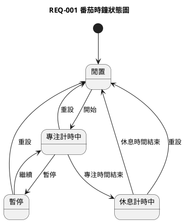

# 個人系統分析 AI 工作台

`sa-spec` 是一個輕量的系統分析文件工作台，用固定流程把需求想法整理成可確認、可歸檔、可檢查的文件。

AI 工作流只使用四個指令：

```text
spec:init
spec:propose
spec:analyze
spec:commit
```

每個需求歸檔後固定包含：

```text
project/
  REQ-001-login/
    srs.md
    uml.puml
    openapi.yaml
    db-schema.md
    handoff.md
    history.md
```

## 設計理念

`sa-spec` 的定位不是單純的 AI 文件產生器，而是 AI 開發前的系統分析工作台。

它的核心價值，是在 OpenSpec、Codex、Claude、Gemini 等 AI 開發工具開始實作之前，先把需求、限制、衝突、權限、資料、API、DB 與驗收條件釐清，讓後續開發有明確邊界。

從資深系統分析師的角度看，最重要的是 `spec:analyze` 會強制進行影響評估，特別檢查新需求是否改變既有角色、權限或資料存取規則。這些區域通常是系統迭代中最高風險的地方，一旦被新需求無意間覆寫，可能造成資安漏洞、資料外洩或業務邏輯崩壞。

`sa-spec` 透過 `propose -> analyze -> commit` 的狀態機，避免 AI 為了產出完整答案而自行補上未確認的欄位、狀態、流程或商業規則。若發現衝突，AI 必須停止產出文件，只列出衝突與待釐清問題，等使用者確認後才能繼續。

每個需求都固定產出 SRS、UML、OpenAPI、DB Schema、handoff 與 history，讓需求從業務邏輯、流程狀態、系統介面、資料結構到開發交接都有跡可循。`handoff.md` 則作為 OpenSpec 或其他 AI 開發工具的入口文件，讓 AI 先讀已確認的限制與驗收條件，再開始開發。

換句話說：

```text
sa-spec 先把需求說清楚，OpenSpec 再把需求做出來。
```

## 安裝前準備

請先安裝：

- Node.js 18 或以上版本。
- npm。
- Git。

確認版本：

```bash
node --version
npm --version
git --version
```

## macOS 安裝

使用 Git 下載專案：

```bash
git clone https://github.com/teyhawzhe/open_sa.git
cd open_sa
npm install
npm link
```

確認 CLI 可用：

```bash
sa-spec help
```

若 `sa-spec` 找不到，請確認 npm global 路徑是否在 `PATH`：

```bash
npm prefix -g
```

macOS 常見執行檔路徑會是該目錄底下的 `bin` 資料夾。

## Linux 安裝

使用 Git 下載專案：

```bash
git clone https://github.com/teyhawzhe/open_sa.git
cd open_sa
npm install
npm link
```

確認 CLI 可用：

```bash
sa-spec help
```

若遇到權限問題，建議調整 npm global prefix，不建議直接使用 `sudo npm link`：

```bash
mkdir -p ~/.npm-global
npm config set prefix ~/.npm-global
```

再把以下內容加入 shell 設定檔，例如 `~/.bashrc` 或 `~/.zshrc`：

```bash
export PATH="$HOME/.npm-global/bin:$PATH"
```

重新載入 shell 後再執行：

```bash
npm link
sa-spec help
```

## Windows 安裝

請使用 PowerShell。

使用 Git 下載專案：

```powershell
git clone https://github.com/teyhawzhe/open_sa.git
cd open_sa
npm install
npm link
```

確認 CLI 可用：

```powershell
sa-spec help
```

若 PowerShell 找不到 `sa-spec`，請確認 npm global 路徑是否在 `Path` 環境變數：

```powershell
npm prefix -g
```

常見路徑類似：

```text
C:\Users\你的使用者名稱\AppData\Roaming\npm
```

把該路徑加入 Windows 的使用者環境變數 `Path` 後，重新開啟 PowerShell，再執行：

```powershell
sa-spec help
```

## 專案初始化

在你要管理需求文件的資料夾執行：

```bash
sa-spec init
```

這會建立最小文件骨架：

```text
AGENTS.md
readme.md
skills/
  system-analysis/
    SKILL.md
project/
  index.md
  system-spec.md
```

若想同時建立完整規則文件：

```bash
sa-spec init --full
```

`spec:init` 規則會檢查 Git 狀態；若目前資料夾還不是 Git repository，會自動執行 `git init`。

### `init` 與 `init --full` 差異

| 指令 | 會建立什麼 | 適合情境 |
|---|---|---|
| `sa-spec init` | 最小文件骨架：`AGENTS.md`、`readme.md`、`skills/system-analysis/SKILL.md`、`project/index.md`、`project/system-spec.md`。 | 想快速開始整理需求，先保持規則簡單。 |
| `sa-spec init --full` | 最小文件骨架，加上 `rules/` 內的 SRS、審核、UML、DB Table、估算、檔案格式等補充規則。 | 想讓 AI 產出的文件格式更一致，或團隊需要比較完整的檢查依據。 |

`rules/` 是補充規則，不是強制流程。即使使用 `sa-spec init --full` 建立完整規則，用戶也可以先不使用或之後自行刪除 `rules/`；基本流程仍會依 `AGENTS.md` 與 `skills/system-analysis/SKILL.md` 運作。

簡單範例：

```bash
mkdir my-spec
cd my-spec
sa-spec init
sa-spec check
```

若後來發現需要更完整的審核與文件規則，可以在同一個資料夾補上：

```bash
sa-spec init --full
```

既有檔案不會被覆蓋；已存在的檔案會顯示為 `SKIPPED`，缺少的規則檔才會被建立。

## CLI 指令

| 指令 | 用途 |
|---|---|
| `sa-spec init` | 建立最小文件骨架。 |
| `sa-spec init --full` | 建立文件骨架與完整規則文件。 |
| `sa-spec new --id REQ-001 --name login` | 建立需求資料夾與空白文件模板，包含 SRS、UML、OpenAPI、DB Schema、handoff 與 history。 |
| `sa-spec check` | 檢查基本文件是否存在。 |
| `sa-spec status` | 顯示系統規格與需求索引狀態。 |
| `sa-spec doctor` | 檢查必要檔案是否存在。 |

`sa-spec new` 是快速建空白模板的輔助工具。正式需求流程仍建議使用 `spec:init`、`spec:propose`、`spec:analyze`、`spec:commit`。

## CLI 與 VS Code 用法

`sa-spec ...` 是 CLI 指令，要在終端機執行，例如 macOS/Linux 的 Terminal、Windows 的 PowerShell，或 VS Code 內建 Terminal。

`spec:...` 是 AI 工作流程指令，要輸入在 VS Code 的 AI 對話側邊欄，例如 Codex、Claude Code、Gemini CLI，或其他已載入本專案規則的 AI 對話工具。

### 建議安裝的 VS Code 套件

至少需要安裝一個能和專案檔案協作的 AI 對話套件。不同使用者可以依自己的帳號與模型選擇其中一種：

| 類型 | 套件或工具 | 是否必要 | 用途 |
|---|---|---|---|
| AI 對話 | OpenAI Codex / ChatGPT 類型的 VS Code AI 套件 | 擇一 | 在側邊欄輸入 `spec:init`、`spec:propose`、`spec:analyze`、`spec:commit`。 |
| AI 對話 | Claude Code 類型的 VS Code AI 套件或 CLI 整合 | 擇一 | 用 Claude 讀取工作區規則並協作產出需求文件。 |
| AI 對話 | Gemini 類型的 VS Code AI 套件或 CLI 整合 | 擇一 | 用 Gemini 讀取工作區規則並協作產出需求文件。 |
| Markdown | Markdown 預覽或 Markdown All in One 類型套件 | 選用 | 預覽 `srs.md`、`history.md`、`system-spec.md`。 |
| UML | PlantUML 類型套件 | 選用 | 預覽 `uml.puml`。 |
| YAML | YAML 類型套件 | 選用 | 編輯與檢查 `openapi.yaml`。 |
| Git | GitLens 類型套件 | 選用 | 查看需求文件修改歷程。 |

最小可用組合：

```text
VS Code
+ 一個 AI 對話套件
+ VS Code 內建 Terminal
+ Git
+ sa-spec CLI
```

Markdown、PlantUML、YAML、GitLens 這類套件可以提升閱讀與檢查體驗，但不是執行 `sa-spec` 或 `spec:*` 流程的必要條件。

| 類型 | 指令範例 | 使用位置 | 用途 |
|---|---|---|---|
| CLI | `sa-spec init --full` | 終端機或 VS Code Terminal | 建立文件骨架與規則檔。 |
| CLI | `sa-spec check` | 終端機或 VS Code Terminal | 檢查必要文件是否存在。 |
| CLI | `sa-spec status` | 終端機或 VS Code Terminal | 查看系統規格與需求索引狀態。 |
| AI 工作流程 | `spec:init` | VS Code AI 對話側邊欄 | 載入規則並確認工作區狀態。 |
| AI 工作流程 | `spec:propose` | VS Code AI 對話側邊欄 | 整理使用者提出的需求。 |
| AI 工作流程 | `spec:analyze` | VS Code AI 對話側邊欄 | 檢查衝突並產出待確認草稿。 |
| AI 工作流程 | `spec:commit` | VS Code AI 對話側邊欄 | 歸檔已確認版本並建立本機 Git commit。 |

建議操作順序：

```bash
mkdir my-spec
cd my-spec
sa-spec init --full
code .
```

接著在 VS Code 的 AI 對話側邊欄輸入：

```text
spec:init
spec:propose
spec:analyze
spec:commit
```

如果你有安裝 prompts 或 slash commands，可以用對應的快捷指令；沒有安裝也可以直接手動輸入上面的文字指令。

## AI 工作流程

| 指令 | 用途 |
|---|---|
| `spec:init` | 初始化並載入 `AGENTS.md`、`skills/system-analysis/SKILL.md` 與必要規則。 |
| `spec:propose` | 使用者提出需求後，整理需求摘要、目標、初步流程與待確認事項。 |
| `spec:analyze` | 檢查是否與既有需求衝突；無衝突才產出 SRS、UML、OpenAPI、DB Schema 草稿。 |
| `spec:commit` | 使用者確認無衝突版本後，將版本歸檔到 `project/`，並建立本機 Git commit。 |

狀態機：

```text
init -> propose -> analyze

analyze 無衝突 -> 產出待確認版本 -> commit
analyze 有衝突 -> 釐清問題 -> analyze

commit -> 歸檔 -> 本機 Git commit
```

`spec:analyze` 若發現衝突，只會列出衝突與待釐清問題，不會修改任何需求文件，也不會產出最終文件。釐清後應再次執行 `spec:analyze`，重新檢查並產出草稿。

`handoff.md` 是給 OpenSpec 或其他 AI 開發工具的開發交接摘要。它會從已確認的 SRS、UML、OpenAPI、DB Schema 與限制整理出「要開發什麼」、「不要開發什麼」、「已確認規則」、「API 契約」、「DB 變更」、「驗收條件」與「開發限制」。它只能整理已確認內容，不得新增未確認的開發假設。

交給 OpenSpec 或其他 AI 開發工具時，應指定它先閱讀 `handoff.md`，並以 `handoff.md` 作為開發入口與限制摘要；其他規格文件作為詳細來源。可使用以下提示：

```text
請先閱讀 project/REQ-001-pomodoro-timer/handoff.md。
以 handoff.md 作為本次開發入口與限制摘要。
如需完整需求細節，再查閱同資料夾內的 srs.md、uml.puml、openapi.yaml、db-schema.md 與 history.md。
不得自行新增 handoff.md 未確認的角色、權限、流程、狀態、API 或 DB 欄位。
若發現 handoff.md 與既有程式或規格衝突，請停止開發並回報。
```

`spec:commit` 完成歸檔後會自動建立本機 Git commit。commit message 會以需求編號與需求名稱為主，並加上簡短需求說明：

```text
docs(REQ-001): 番茄時鐘 - 新增專注與休息計時需求
```

只有在使用者明確要求推送 remote，或專案設定啟用 auto-push 時，才會執行 `git push`。如果 push 失敗，只回報認證或網路問題，不會回滾已完成的文件歸檔與本機 commit。

## 完整範例：番茄時鐘

以下示範從空資料夾開始，建立一個「番茄時鐘」需求。

### 1. 建立工作資料夾

```bash
mkdir pomodoro-spec
cd pomodoro-spec
sa-spec init --full
```

確認狀態：

```bash
sa-spec check
sa-spec status
```

預期會看到 `AGENTS.md`、`skills/system-analysis/SKILL.md`、`project/index.md`、`project/system-spec.md` 都存在。

### 2. 啟動 AI 流程

在支援此專案規則的 AI 對話中輸入：

```text
spec:init
```

AI 會讀取規則、確認 `project/` 結構，並回報 Git 狀態。

### 3. 提出需求

輸入：

```text
spec:propose

我想做一個番茄時鐘，使用者可以設定專注 25 分鐘、休息 5 分鐘。
可以開始、暫停、繼續、重設計時。
時間結束時要通知使用者。
先不用登入，也不用同步到雲端。
```

AI 應先整理，而不是直接歸檔：

```text
需求摘要：
- 建立番茄時鐘功能，支援專注與休息計時。

目標：
- 讓使用者可以用固定週期管理工作與休息時間。

初步流程：
1. 使用者設定專注時間與休息時間。
2. 使用者開始專注計時。
3. 使用者可暫停、繼續或重設。
4. 專注時間結束後，系統通知使用者並進入休息計時。
5. 休息時間結束後，系統通知使用者。

待確認事項：
1. 時間結束通知要用瀏覽器通知、音效，還是畫面提示？
2. 是否需要記錄完成幾輪番茄鐘？
3. 設定時間是否需要保存到下次開啟？
```

使用者補充確認：

```text
1. 通知先用畫面提示和音效。
2. 需要記錄本次開啟頁面後完成幾輪，不需要永久保存。
3. 設定時間只保留在本次頁面，不需要資料庫。
```

### 4. 分析與起草

輸入：

```text
spec:analyze
```

AI 必須先檢查 `project/` 內所有既有需求，包括：

- 是否與既有需求目標或流程重疊。
- 是否改變既有角色、權限或資料存取規則。
- 是否影響既有 API。
- 是否影響既有 DB Table。
- 是否與既有驗收條件矛盾。

若沒有衝突，AI 會產出待確認草稿，包含：

```text
需求編號：REQ-001
需求名稱：番茄時鐘
狀態：待確認

SRS 草稿：
- 需求摘要
- 業務目標
- 使用者與角色
- 前置條件
- 主要流程
- 例外流程
- 功能需求
- 非功能需求
- 驗收條件
- 待確認事項

UML 草稿：
- 依需求選擇活動圖或狀態圖。

OpenAPI 草稿：
- 若本需求不需要後端 API，需明確標示「無 API 需求」。

DB Schema 草稿：
- 若本需求不需要資料庫，需明確標示「無 DB 需求」。

Handoff 交接摘要草稿：
- 整理給 OpenSpec 或 AI 開發工具使用的開發交接摘要。
- 明確列出要開發什麼、不要開發什麼、已確認規則、API 契約、DB 變更、驗收條件與開發限制。

project/system-spec.md 更新建議：
- 建議新增番茄時鐘模組摘要。

本次未修改其他需求。
```

番茄時鐘的 UML 可能選擇狀態圖，因為此需求重點是計時器狀態：



### 5. 使用者確認

若草稿內容正確，輸入：

```text
我確認這版番茄時鐘需求，可以歸檔。
```

接著輸入：

```text
spec:commit
```

AI 才能把已確認版本寫入需求資料夾、更新索引與歷程，並建立本機 Git commit。

### 6. 歸檔後結構

完成後預期會有：

```text
project/
  index.md
  system-spec.md
  REQ-001-pomodoro-timer/
    srs.md
    uml.puml
    openapi.yaml
    db-schema.md
    handoff.md
    history.md
```

`handoff.md` 會整理給 OpenSpec 或 AI 開發工具使用的交接內容，例如：

```text
要開發什麼：番茄時鐘前端計時功能。
不要開發什麼：登入、雲端同步、永久資料保存。
API 契約：無 API 需求。
DB 變更：無 DB 需求。
開發限制：不得自行新增未確認的角色、狀態、API 或 DB 欄位。
```

交給 OpenSpec 開發時，可以直接指定：

```text
請先閱讀 project/REQ-001-pomodoro-timer/handoff.md，並以 handoff.md 作為本次開發入口與限制摘要。
```

`project/index.md` 會新增一列：

```text
| REQ-001 | 番茄時鐘 | 使用者可進行專注與休息計時 | 待確認或已審核 | 建立時間 | 更新時間 |
```

`history.md` 會記錄本次歸檔，例如：

```text
| 時間 | 版本 | 類型 | 說明 | 來源 | 影響範圍 | 風險 | 狀態 |
|---|---|---|---|---|---|---|---|
| 2026-05-29 21:30 | v0.1 | 新增 | 建立番茄時鐘需求草稿 | 使用者確認 | SRS、UML、OpenAPI、DB Schema、Handoff | 低 | 待確認 |
```

### 7. Git commit 與 remote push

`spec:commit` 完成後，AI 會自動建立本機 Git commit，例如：

```text
docs(REQ-001): 番茄時鐘 - 新增專注與休息計時需求
```

可以用以下指令確認：

```bash
git status
git log -1 --oneline
```

若要推送到 remote，需要明確要求 AI 執行 push，或自行執行：

```bash
git push origin main
```

若分支是 `master`：

```bash
git push origin master
```

## 注意事項

- 未經使用者確認，不得標示為 `已審核`。
- `spec:analyze` 發現衝突時不得產出最終文件，也不得修改既有需求文件。
- `project/system-spec.md` 只能在 `spec:commit` 依使用者確認內容更新。
- `spec:commit` 會自動建立本機 Git commit；remote push 需使用者明確要求或啟用 auto-push。
- 一次最多問 3 個待確認問題，優先詢問會影響範圍、資料、權限、API、DB 或驗收的問題。
